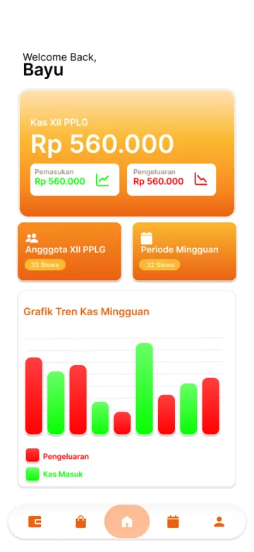
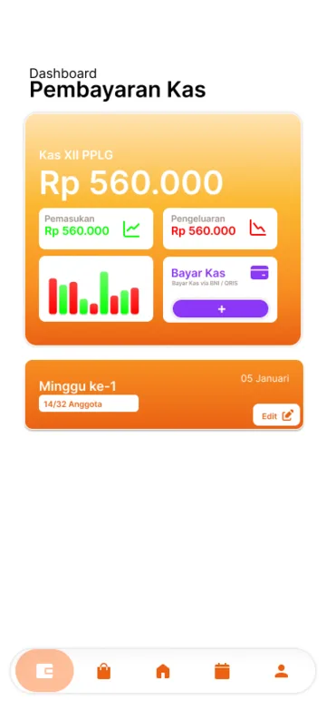
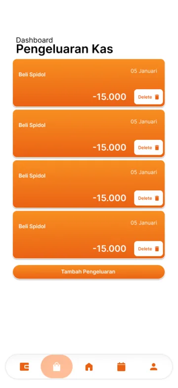
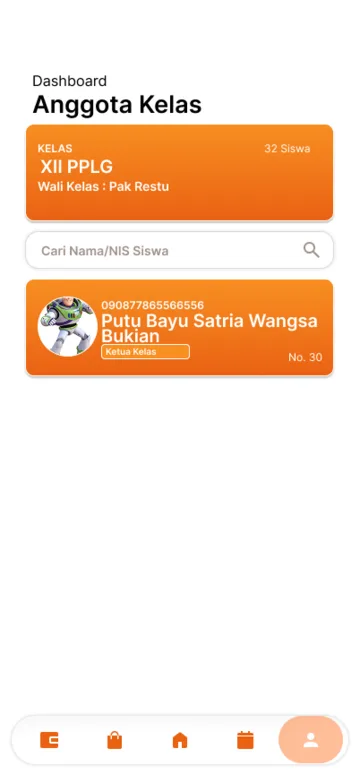

# AppCash

Aplikasi Android untuk mencatat kas kelas XII PPLG, SMKN 2 Kuta Selatan. Dibuat oleh Kelompok 6. Siswa masuk cukup dengan memilih nama, bendahara masuk dengan email, dan semua data tersimpan di HP.

[](https://github.com/zynxx24/AppCash/releases/latest)


**[Unduh APK terbaru](https://github.com/zynxx24/AppCash/releases/latest)**

<p>
  
  
  
  
</p>
<sub>Gambar dari desain Figma di folder <code>design_new/</code>.</sub>

## Cara kerja kas di aplikasi ini

- Kas Rp5.000 per minggu, dicatat per minggu (M01 sampai M37).
- Denda 5% dari kas untuk setiap minggu yang belum lunas, dikali jumlah bulan penuh keterlambatan. Contoh: 3 minggu yang telat 2 bulan = 3 × Rp250 × 2 = Rp1.500. Telat kurang dari sebulan belum didenda.
- Siswa yang sedang BI atau PKL mendapat dispensasi: minggu itu tidak wajib dan tidak didenda.
- Siswa membayar lewat transfer BNI atau QRIS, lalu mengirim bukti ke WhatsApp bendahara. Tombol konfirmasi baru aktif setelah bukti terkirim. Bendahara yang mencentang minggu yang lunas.

## Fitur

Lima tab di bawah layar:

| Tab | Isi |
|---|---|
| Kas | Bendahara: saldo, daftar 37 minggu, centang pembayaran per minggu. Siswa: status dan riwayat per minggu, dialog bayar BNI atau QRIS |
| Pengeluaran | Daftar dan total pengeluaran. Bendahara bisa menambah, mengubah dan menghapus |
| Dashboard | Saldo, jumlah anggota, periode, grafik kas per bulan, rekap denda (bendahara), dan pencocokan saldo buku dengan uang fisik di peti kas |
| Anggota | 33 siswa dengan foto, kolom cari nama atau NIS, bio, tombol hubungi WhatsApp. Bendahara bisa mengubah data |
| Profil | Data akun, kartu denda, edit profil, keluar |

Foto siswa dikecilkan jadi thumbnail dan dibaca dengan subsampling plus cache, supaya daftar anggota tetap lancar di HP kelas bawah.

## Build dari source

Butuh JDK 11 atau lebih baru dan Android SDK 35. Proyek Android ada di folder `appcash-android/`.

```bash
git clone https://github.com/zynxx24/AppCash.git
cd AppCash/appcash-android
./gradlew assembleDebug     # app/build/outputs/apk/debug/
./gradlew assembleRelease   # dengan R8 dan shrink resource
```

## Isi repo

```
appcash-android/   proyek Android Studio
  app/src/main/java/com/appcash/
    data/            Models.kt, AppCashRepository.kt (rumus saldo dan denda, simpan ke HP)
    network/         ApiService.kt (klien Retrofit untuk server lokal)
    ui/              MainActivity.kt (5 tab) dan screens/
design_new/        desain Figma
foto_siswa/        foto asli siswa untuk avatar
AppCash.apk        APK terakhir yang dibangun
AppCash.zip        arsip proyek
```

## Untuk presentasi

Di dalam `appcash-android/` ada empat dokumen untuk tanya jawab dengan guru:

- [PETA-LAYAR.md](appcash-android/PETA-LAYAR.md): yang terlihat di layar, beserta file dan nomor barisnya
- [TANYA-JAWAB.md](appcash-android/TANYA-JAWAB.md): perkiraan pertanyaan beserta jawaban dan letak kodenya
- [KAMUS-KODE.md](appcash-android/KAMUS-KODE.md): arti istilah Kotlin dan Compose dengan bahasa sederhana
- [PETA-KODE.md](appcash-android/PETA-KODE.md): daftar penanda `CARI-...` dan `TANYA-GURU` di kode

Aplikasi saudaranya: [KasTep](https://github.com/zynxx24/KasTep) (Kelompok 1) dan [KasKu](https://github.com/zynxx24/kasku) (Kelompok 8).
